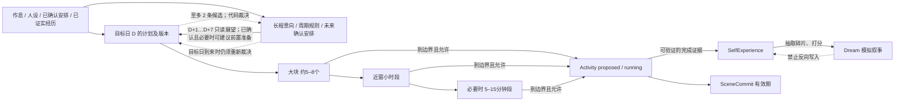

# 她的一天：日程、状态与梦境设计

> 架构决策稿，供实现与验收使用；**阶段 1 已实现（`47a626c`），本文的 21:00/午夜改版与多日展望尚未实现**。依据是 `docs/DREAM-SCHEDULE-RESEARCH.md` 与当前源码。文中阈值、预算和权重均为**工程初值**，不是论文测出的系数。所有时间戳入库为带时区的 UTC 瞬时值；用户看到的钟点由 IANA 时区投影。

## 0. 先质疑需求，再定最小形态

长期陪伴感的必要条件不是“她每分钟都有一段故事”，而是**可预期但可改变的意向、与事件相符的状态、可信的记忆边界**。若把日程直接喂给“我做过什么”，系统很快会编造人生。现有 `AgendaService` 明确规定计划不是事实；`ActivityService` 要求完成证据。新增能力必须先服从这两个约束。

| 对原需求的质疑 | 建议与理由 | 坚持原话的代价 |
|---|---|---|
| 真需要全天分钟级吗？ | 默认只排 5–8 个大块；未来 2–3 小时才按需细化，只有事件密集块用 5–15 分钟。分钟级是**计划精度**，不是按分钟制造经历。[Generative Agents §4.3](https://arxiv.org/abs/2304.03442) 证明分层规划可行，但“只保留近窗细节”是本项目的成本选择。 | 约 24 小时 × 每小时多条；token、校验、重排成本上升，且细节被现实聊天频繁推翻。 |
| 何时生成，谁在“想”？ | **D−1 本地 21:00 后台调用模型生成 D 的日程**；这是系统批处理，不是她在此刻思考或做出承诺。计划日按 D 的午夜切分，生成与日界分离。 | 沿用 04:00 会漏掉 D 的凌晨；把 21:00 写成角色行为，会伪造经历。 |
| “每天生成一整天”和“她决定要不要去”能同时成立吗？ | 大纲是可变意向，只有睡眠、已确认承诺、正在执行的活动是锚点；提议触发局部修订。 | 把全天排成不可变脚本，会让拒绝/临时起意失去意义；每次全量重生则容易破坏承诺。多轮约束难度见 [Flex-TravelPlanner](https://arxiv.org/abs/2506.04649)。 |
| 要不要一次生成未来数天的大纲？ | D−1 21:00 仍只生成 D；同时读取未来 7 个本地日的意向、已确认安排与周期规则的**确定性展望**，允许 D 中出现有根据的前置准备。方案比较和代价见 §3A。 | 未来多日批量大纲会增加调用、版本和午夜接缝数量，并把“可能”误呈为已定。 |
| 梦是不是可以直接复述前几天经历？ | 不可以。先提取人、地点、动作、情绪碎片再重组，梦只作虚构叙事；[Malinowski & Horton 2014](https://pubmed.ncbi.nlm.nih.gov/24635722/) 支持碎片性，未支持“日程原样入梦”。 | 把行程摘要直接生成梦，会得到伪装成回忆的流水账，污染自我经历。 |
| 天气是否一定改变心情？ | 先让模拟天气影响可选活动与场景，不默认驱动情绪。天气对情绪的总体效应小且个体差异大，见调研 §4.3 所引 [Denissen 2008](https://doi.org/10.1037/a0013497)、[Klimstra 2011](https://doi.org/10.1037/a0024649)。 | 强行“下雨就难过”会使人格公式化；接真实天气 API 又要定义地理位置、来源与有效期。 |

**最小可行形态**：D−1 21:00 后台为角色本地日历日 D 生成一个可修订计划版本、非等长大块、未来 7 天确定性展望与有来源的长程意向、未来窗口细化、基于事件的局部重排、独立的梦报告、状态惰性结算、只读时间轴。宁可显示“今天暂时没什么特别安排”，也不把计划时间的经过算作事情已做。阶段 1 的大纲与确定性兜底已落地；阶段 1.5 先修正日界与输入，再接后续阶段。**不做**：全天预生成分钟剧本、每个 tick 调模型、真实人体健康/地理轨迹、REM 检测、梦的现实回执、把 tentative 计划说成“约好”、自动推送日程/梦给聊天用户。

模型预算按**角色的计划日**计，调用前预算预留、实际 token 由既有 provider quota 再把关；输入/输出是硬上限估算，不是价格承诺。使用现有已发布 `memory.extract` 模型职责，无法解析时走规则兜底；不悄悄借用 `dialogue.fast`。未来若有专用 `planning` 职责，再显式迁移配置，不假装当前已有该职责。

| 调用 | 触发及次数上限 | 每次输入/输出上限 | 每计划日上限 |
|---|---|---|---|
| D 大纲 + 至多 2 条未来意向提议 | D−1 21:00 唯一到期作业；非法结果最多一次修复重试；**不为 D+1…D+7 另调模型** | 3,100 / 1,200 | 2 次，8,600 token |
| 近窗细化 | 窗口接近且确有粗块；每滚动 3 小时最多 1 次 | 1,000 / 800 | 4 次，7,200 token |
| 临时重排 | 有新提议且硬门允许；同一 `turn_id` 最多一次，同一聊天窗口每小时最多一次 | 1,500 / 800 | 2 次，4,600 token |
| 梦境 | 有候选素材且靠近醒时；超时不做第二次模型调用 | 2,000 / 700 | 1 次，2,700 token |

上界 **9 次、23,100 token/角色/目标计划日 D**（原上界 9 次、21,500；只增 1,600 token，不增调用）；典型日按新封顶约大纲 1 次 + 细化 2 次 + 梦 1 次 = 4 次、10,600 token（原 9,800），实际常低于封顶。这些都是**工程初值**。21:00 只创建 D 的**一个**初始大纲作业；修复重试、断线补跑沿用该作业和预算，不在午夜或醒来时再全量生成，接缝变化走局部修订。展望查询与意向到期清理为确定性代码、0 次模型；日常大纲调用顺带可提议至多 2 条意向，不开第二种模型任务。无候选、无新边界、无可用模型、预算耗尽均 **0 次**。聊天窗口“每小时一次”只限制重排模型调用，不限制她回应、拒绝或记录提议；另有全角色每日 2 次重排上限。预算闸是成本控制，不是精确审计，精确 usage 继续由 `TokenQuotaStore` 记录；多 worker 下预算预留必须落库，不能直接照搬进程内 `WatchBudget`。这沿用调研 §3.2 的分层规划思路；21:00、7 天与额度数值是产品排程选择，不是文献结论。

## 1. 概念与写入边界



日程三层都是**意向**：大块是“打算做什么”，小时/分钟是“若无新事，可能怎样做”；这里的“打算”是角色可读的计划投影，**不意味着她经历了制定计划的心理事件**。只有叶段用于启动活动；父段与子段有意重叠，不能把三层都当并列任务。`running` 是模拟世界当前进程，不自动证明真实世界发生；`completed + completion_evidence` 才能进入 `SelfTimelineService`，并保留 `origin`。睡眠块只表达预期休息窗；不能仅凭时钟写“我睡着了/做了梦”。梦是独立的**模拟叙事**，不是活动、计划或记忆事实。

复用与取舍：

| 所有者 | 本设计动作 | 不选的路及原因 |
|---|---|---|
| `agenda/service.py`、`actor_routines` | 保留软作息和旧 `agenda_plans` 的最多 4 件小事；由 `AgendaService` 作为时间轴唯一写入入口，新增 `agenda/timeline.py` 处理版本树。作息表不加列。另建 `schedule_intentions` 与 `schedule_recurrence_rules` 承接有日期的长程可能性，不能复用现有 `intents`：后者是跨轮 `reply/note/act/reach_out` 念头，按 `not_before/expires_at` 触发，并无目标日区间或日程承诺语义。 | **不把全天段塞进 `agenda_plans`**：其 `MAX_LIVE_PLANS=4`、`state=done` 语义和旧 API 都是“小事”；塞 20–40 段会破坏现有约束。`AgendaPlanRow.revision` 是单条小事版本，不能代替整日修订号。 |
| `activity/service.py`、`activities` | 加可空 `schedule_segment_id`；活动状态机和证据规则继续唯一写入。旧 `plan_id` 保留指向 `agenda_plans`。 | 不复用 `plan_id` 偷指新表；同一个字符串指两张表会失去外键和审计能力。 |
| `presence/service.py`、`presence_states` | 加 `satiety` (0–100) 与同一 `settled_at` 惰性结算；`scene_commits` 仍是当前状态且带 `valid_until`。饥饿低只影响选择，不阻断直接答复。 | 不建“饥饿 tick”或独立位置表；否则与已有精力结算、当前活动地点冲突。 |
| `affect/service.py`、`affect_states` | 保留现有 `emotion/intensity/decay_per_hour` 的**线性**衰减和 global/window 隔离；加 `valence/arousal` 可空列，写入时由 OCC 映射规则确定，并新建短期 `affect_signals` 留住梦需要的日内峰值。 | 调研 §4.1 建议二维状态与“指数衰减”，但源码实际是线性；不能宣称复用指数衰减。第一阶段不换衰减公式，免得旧情绪突然变长或变短。单靠当前 `affect_states` 无法回看日内峰值。 |
| `world/service.py`、`world_places` | 地点继续是模拟地点。活动当前位置取运行中活动/有效 scene 的 `place_id`，计划地点取段的 `place_id`。后期新建 `world_weather_states`，只存有来源、有效期的模拟天气。 | 不往 `world_places` 塞“当前位置/天气”：地点是静态词典，天气是随时间变的投影；现实天气必须另有可信来源，首版不接。 |
| `goals/service.py`、`commitments`；`phone/service.py`、`proactive` | 对人的承诺是不可移动锚点；看手机与主动联系保留各自状态机和门控，只读取日程的“忙/休息”提示。 | 不用 `commitment_level=confirmed` 的日程条目替代 `CommitmentRow`，后者才有履约与投递状态。日程不直接发送消息。 |
| `memory/self_timeline.py` | 继续只从有证据的完成活动派生。新增过滤：时间到点/仅模型自述不构成 `completion_evidence`；梦不可进入 backfill。 | 不把梦写 `self_experiences` 再贴 `origin=simulated`：检索者容易漏过滤；从结构上隔离更可靠。 |

情绪事件映射采用有限规则，例如“用户欢迎提议”→ `warm`、负性聊天事件→ `uneasy`，按事件有利/不利、归因、确定性决定类别（[OCC](https://doi.org/10.1017/cbo9780511571299)）；二维值只是连续强弱与语气辅助（[Russell 1980](https://doi.org/10.1037/h0077714)）。低精力、低饱腹和坏天气可降低**可选活动**的可行性，不能改变安全/隐私/答复义务。模型只能提议“这顿饭是否令人满足”；最终加饱腹必须有活动完成与吃饭证据，不能因为计划了早餐就 +35。[Humanoid Agents](https://arxiv.org/abs/2310.05418) 只支持粗需求变量能影响活动分布，不提供本项目的 `+35` 或阈值。

## 2. 时间轴语义：计划日、展示日与生成时刻

**计划日 D** 是角色规范时区的本地 `[D 00:00, D+1 00:00)`，`plan_day=D`；**生成到期时刻**另为角色本地 `D−1 21:00`。展示日仍是当前用户有效时区的本地 `[D 00:00,D+1 00:00)`。单角色部署用 owner subject 的 `load_user_timezone` / `effective_user_timezone`（`settings/user_preferences.py`，DB > env > `Asia/Shanghai`）解析规范时区并写快照；`ActorRoutineRow.timezone` 旧值须对齐或显式报冲突，worker 不得用它另算日界。多用户共享角色的 UTC 计划，按各自时区裁剪展示；非 owner 的展示时区不改角色计划。**不沿用 04:00 日界**：那会让 D 的 00:00–04:00 必须由 D−1 的跨日计划承担，与“前夜为 D 的整日生成”不符；也不把 21:00 当日界，因为 21:00–24:00 仍属于 D−1 的生活。

睡眠按 `ActorRoutineRow` 的“非清醒区间”与 D 的午夜窗口求交，形成**至多两段、都完全归属 D 的规则锚点**。通常 `wake=08:00, rest=23:00` 时，D−1 21:00 的同一后台作业**由代码**生成 D 的 `[00:00,08:00)` 预计睡眠和 `[23:00,24:00)` 预计睡眠，模型只生成其间可选活动；D 的 `00:00–03:31` 也在第一段里，**不是** D−1 计划的跨夜段，`03:31` 为最后包含分钟时入库末端仍为 `03:32`。若 `wake=10:00, rest=02:00`，D 只有 `[02:00,10:00)` 睡眠，午夜到 02:00 是清醒时间；若 `wake=rest`，现有作息语义为无有效睡眠窗，不凭空造睡眠。一个自然睡眠过程可跨两个计划日，但**存储段必须在 00:00 分开**；梦与睡后结算仍按同一预计醒点去重，不因拆段运行两次。后夜 `[D 23:00,D+1 00:00)` 在 D 中，次日 `[D+1 00:00,08:00)` 在 D+1 中，两份计划对接只比对作息与事件来源，不复制当前叶段。睡眠锚点只表示“预计休息”，不证明已睡着。这里的分段和 21:00 时刻是工程决策；调研 §3.1 的 7–9 小时仅作兜底参考，不是必须让模型填满的定律。

**21:00–24:00 接缝**：D−1 晚上的聊天、确认邀约、作息/时区变化一旦入库，事件处理器立刻找受影响的 D 计划，对未来交集做硬约束复核；若产生新的已确认锚点，则同一事务先保留/登记锚点并把冲突的可选段局部标为 `superseded`，再在预算允许时只重排**新锚点两侧受影响、被相邻硬锚点界定的未来空档**，不扩展到整天。没有预算或模型失败，就保留锚点与空档、标 `needs_review`，不能静默留着冲突的可选段。00:00 再做一次**零模型接缝校验**（修补遗漏事件和两日睡眠边界）；它可确定性地取消冲突段/标记待处理，**不重生成**。例如 22:10 用户确定了 D 07:00 的事，22:10 就更新 D 的锚点和局部计划；等 00:00 才生成会丢掉及时修订，还会重写未受影响的整天。单纯聊天提及“明天”但未确认的内容只当候选，不能升为硬承诺。

内部全用左闭右开 `[start_at,end_at)`；时间粒度 1 分钟，开始/结束可在任意分钟，不强制整点。叶段互不重叠；允许空档，它表示自由/未决定，UI 不得虚构“正在做某事”。父子段的重叠合法；每个子段必须落在父段内。睡眠/confirmed 锚点之间有空档也合法。只要求 `start < end`、时长合理、预计睡眠与承诺保护窗显式呈现、外出地点存在、不能跨不可移动锚点，不要求全日覆盖。模型返回的“早餐吃了什么、想到了什么”只能是**预计细节/意向**；真正吃了什么、想到了什么需活动证据或明确的聊天事件。

DST：计划日边界按本地墙钟组合、再转 UTC，不用 `+24h`；一天可为 23/25 小时。生成的本地时刻若不存在，顺延到该日下一个有效分钟；若重复，选第一次出现的瞬时值（`fold=0`）并记录 `offset/fold`；既有锚点以 UTC 瞬时值为准。校验和去重均用 UTC 半开区间，不用 `HH:MM` 字符串。21:00 也必须按同一墙钟规则计算，不能由 UTC 前推固定 3 小时求午夜。改规范时区或 wake/rest 后，**过去、running、已确认承诺不改**；按 UTC 相交区间定位受影响的既有计划行，在相应行 `revision+1`，只调整未来可选段和预计睡眠的未开始部分。新时区使本地日期变动时，先处理旧/新窗口交集和当前行，不凭新 `plan_day` 直接插入重叠当前叶段；在下一个目标日本地 21:00 对尚未生成的目标日建行，午夜校验边界。`timezone_revision` 只跟规范时区变化，`routine_revision` 独立跟作息变化；旧实现把二者共用递增的部分须在阶段 1.5 收口。这些切换规则都是工程初值，不是文献结论。

## 3. 调度、状态机与成本边界

`worker.py` 保留 `PERIODIC_JOBS`，增加**只检查 DB 到期边界**的 `life.schedule` 每分钟任务（工程初值；健康运行时在 21:00–21:01 投递）；每次按角色规范时区计算“当前本地日 +1”的 21:00 到期点，也检查 00:00 接缝、细化窗口、梦窗口、sleep settlement 与失效 lease。定时扫描只登记一次到期作业；真正模型调用由登记的 `@handler` 接受 outbox 事件，`OUTBOX_TOPICS` 与 worker dispatch 测试同步更新。事件和作业登记在短事务内，worker 重启扫描 DB 补投。阶段 1 的 `run_due_outline` **尚无调度接线**，只会按 04:00 当前计划日推算；不得原样挂进周期任务，须改为明确目标日 D、21:00 due、午夜接缝三条分支。旧 `life.plan` 现为“醒后排 1–3 件”、`_LAST_PLAN_DATE` 为进程内去重；新时间轴启用后须对同 actor 关闭其自动生成，不能并行生成两套；旧 `agenda_plans` 和手工小事继续可读。旧 `life.tick` 300 秒可保留，但须区分旧小事与新时间轴段。

**21:00 管线**：① 解析目标 D/规范时区，取同一事务可核对的作息、承诺、确认小事、已有 D 版本、人设和受众许可的已证实经历/关系、有效地点与当前状态，**并取 D+1…D+7 的有界展望及意向 revision**，记各源 revision/更新时间；② 由代码构造睡眠及确认安排的 UTC 锚点、冲突清单与可排区间，预算/模型可用性预检；③ 唯一作业获取 lease，事务外以 `memory.extract` **调用模型生成**非睡眠可选大块及可空的未来意向提议；④ 严格解析与 `validate_outline`，复核锚点版本、意向版本、过去时间、地点和已结构化为可判定规则的 persona 边界，非法结果最多一次完整修复；⑤ 短事务中 `CAS` 提交 `day_plans` revision 与段，并按 §3A 独立裁决未来意向提议，或规则锚点兜底；⑥ 发只含 ID/原因码的 outbox/`ling.behavior` 事件。自由文本边界若无法映射为代码可判定规则，只能作为模型提示与人工审查项，**不能宣称程序已经验证它**；若涉及安全/权限而无法判定，拒收相关候选段。输入版本在模型调用期间变了，丢弃旧回答，先保住新硬锚点，再按同一预算局部修订；不能提交过期快照。大纲模型输出 schema 扩为 `{"segments":[{"kind","title","start_at","end_at","place_id","flexibility","intention_id?"}],"intention_proposals":[{"theme","target_start_day","target_end_day","source_ref","prep_hint?"}]}`；`intention_proposals` 可缺省/为空，最多 2 条，`source_ref` 只可引用输入中允许提议的来源 ID，所有字段长度和枚举有界；`intention_id` 只能引用已确认且未撤回的输入意向，且只是段的来源链接。目标仍为 5–8 个非睡眠大块，可少但不编空档；模型不得输出睡眠、梦、完成状态、新地点 ID 或意向状态。细化仍只给单个父块、近窗与锚点，输出 `{parent_id,children:[{layer,start_at,end_at,title,kind,place_id}]}`；只允许落在父块与未来窗口内。模型只**提议可选意向**，代码决定锚点、冲突、裁剪、是否接纳、`is_leaf` 与落库；不采用让模型自己“保证承诺不冲突”的路线，因为多轮约束可靠性有限（调研 §3.3 [Flex-TravelPlanner](https://arxiv.org/abs/2506.04649)）。21:00 到期或确有版本变化才有意义；空 tick 不调用。

**约定/安排输入与优先级（工程初值）**：按目标 D 的 UTC 半开窗口查询，所有来源带 `source_id`/版本/状态，跨窗口记录取交集但不改源记录。优先级从高到低：

| 来源 | 取法与进入模型的最小信息 | 裁决 |
|---|---|---|
| `CommitmentRow` | 同 actor、`state=active`、`due_at` 的 `[due,due+60min)` 保护窗与 D 相交；包括她答应**别人**的事，保留 `subject_id`/履约与投递状态，受众不许看时只给模型“有不可移动约定”及时间，不泄漏文本。 | 履约中的硬承诺优先于可选活动和软作息；取消/已履行的不再占未来时段。`due_at` 只有时刻，60 分钟是**工程初值保护窗**，不谎称承诺本身要一小时。 |
| `agenda_plans` | `commitment_level=confirmed AND state IN (planned,active)` 且区间相交；保留原区间和来源事件。 | 已确认区间不可由大纲模型挪动；与同源 `CommitmentRow` 去重，来源不同且重叠则报告冲突，不能默默删其一。 |
| 对话中的“明早叫我”等 | 只读已由 intent/commitment 流程**确认并落库**的上述记录，按事件 ID 去重；未确认或语义不明的原话只进待确认候选，不直接把聊天原文当锚点。 | 新确认事件立即触发 D 计划局部复核；对话摘要不能越过承诺状态机。 |
| 已有 `ScheduleSegmentRow` | 重排时取 D 当前 revision 的叶段、运行中活动关联段与历史版本 ID；过去/运行中/已完成段不可动，未来 `model` 可选段为可替换候选。 | 旧段不能反过来压过新确认承诺；原样保留不受影响段，冲突段 `superseded` 并留引用。 |
| `ActorRoutineRow` 与 tentative 小事 | 取 `wake_minute/rest_minute/timezone/revision` 生成预计睡眠片段；tentative 小事、目标、习惯作为软偏好，附来源和置信边界。 | 作息优先于普通可选活动，却不覆盖已确认的 07:00 叫醒承诺；若承诺落在 08:00 起床前，保留承诺、缩短/分裂**预计**睡眠并标 `routine_conflict`，若低于睡眠保护下限则 `needs_review`，不擅自取消承诺或声称她已醒。 |

同级硬约定彼此冲突时，以真实承诺/确认记录为准全部留在来源表，时间轴只显式显示冲突和 `needs_review`，不让模型选一个“赢家”；履约应由各自状态机解决。安全/权限和真实外部操作的门控始终高于日程。人设、心情、能量、天气仅改变**可选活动的选择和表达**，不得降低答复/履约权利。睡眠是软作息投影，普通可选段不能挤掉它，但它也不能当作拒绝履约的借口。这比把所有来源拼成一段自然语言让模型仲裁更可追溯。

**`persona_summary` 构造（工程初值）**：阶段 1 的 `_persona_summary` 当前仅取 `display_name/name` 与 `traits` 前 8 项，不足以满足本需求。改为确定性、受众过滤后的结构化投影：从 `Persona.name/display_name` 取身份称谓；从 `traits` 中按稳定键选性格、价值观、生活习惯、兴趣和说话口癖；从 `boundaries` 取安全/关系边界；从与日常安排有关的 `scenario_prompts` 只取适用场景的短规则。`relationship_states` 与 `core_memories` 改由下面的**独立记忆预算**装配，避免同一私密信息重复出现。每类先限条数/单条长度，再按固定优先级压到 **≤400 输入 token**，超过时先去可选场景和口癖细节，绝不挤掉边界、核心价值观和作息相关习惯；token 估算以实际 provider tokenizer 为准，不能用截取中文字符冒充精确 token。缺字段写“未知”，不能从空白处编人格。**完整 `system_prompt` 不进日程调用**；若关键设定只存在其中，须在人设编辑/迁移时人工或确定性提取成可审计的结构化短项，不能每晚全文截断喂入。人设是“可判定的硬边界 + 其余软选择/风格”：结构化后能由代码验证的权限/安全边界才算硬门，自由文本仍只影响模型提议；夜猫子倾向可让模型优先选晚间可选活动，**不能自行覆盖**已配置的 `wake_minute/rest_minute`，要改作息须走 `ActorRoutineRow` 的显式配置与 revision。人物关系只影响她可能愿意为谁留余地，不生成对那人的新承诺。这比把整段 system prompt 当作日程指令能减少冲突、注入与隐私外泄。

**D 大纲输入清单与截断顺序（均为输入 token 工程初值，总封顶 3,100）**。装配器先按受众/来源过滤，再按字段上限压缩；若 provider tokenizer 不可用，采用保守估算并继续删低优先级项，绝不截断锚点或权限规则。表内只计可传模型的摘要；完整来源 ID/版本保留在审计快照，**允许模型提出意向的来源另给匿名短 ID**，供输出 `source_ref` 引用并计入该类 token。3,100 中以下上限合计 2,450，另留 650 给序列化、时区/DST 说明、冲突码及 tokenizer 偏差；超过总额先删可选近况、窗口话题和天气，仍超则规则兜底而不漏硬约束。

| 输入 | 取数、压缩与可信度 | 上限 |
|---|---|---:|
| 固定指令/schema | 计划非事实、只输出 D、意向提议不能自行确认；固定模板，不含用户原话 | 300 |
| 人设 | 上述 `persona_summary`，边界与作息习惯优先 | 400 |
| D 的硬锚点/作息/地点 | `load_commitment_anchors` + `ActorRoutineRow`，按 UTC 区间、来源 ID、冲突码；不可授权的承诺只给“占用时间”；地点只给有效 ID/短名 | 480 |
| D+1…D+7 展望 | `schedule_intentions`、周期规则和未来确认安排，每日最多 2 个高优先项；只给目标日/区间、状态、来源类别、准备依赖和短主题，**不提供未来日模型大纲** | 420 |
| 近期已证实经历 | `self_experiences` 最近 72 小时，最多 4 条，必须有 `completed` 活动及非 clock-only `completion_evidence` 或其他明确事实源；只给短摘要/时间/来源 ID，模拟经历带 `origin` | 260 |
| 核心记忆 | `core_memories` 仅当前 owner subject `active`、许可范围内按 `priority` 前 3 条；提取边界、长期偏好/重要日期的**摘要**，不整段注入 `text` | 120 |
| 关系 | `relationship_states` 只取当前 owner 或已授权关系至多 2 个的角色/偏好/边界摘要，不含别人的标识、信任数值或私聊细节 | 100 |
| 窗口上下文 | `window_contexts` 只取**当前 owner 私聊且未过期、已授权参与计划**的窗口最多 1 份，抽取未了安排/话题摘要；21:00 后台无合格窗口时为 0，不扫别人的窗口 | 80 |
| D−1 近况 | D−1 的 `day_plans` 只作“原本打算”与有证据 `self_experiences` 分栏，最多 2 个差异摘要；不把计划段说成已发生 | 160 |
| 当前状态/天气 | `presence_states` 精力/饱腹、仅 global `affect_states` 的当前情绪强度（window 情绪不跨窗口）、`world_weather_states` 有效且有来源才给天气；未建/过期写 unknown | 130 |

优先级：权限/安全与 D 硬锚点 > 已证实经历和经确认的未来依赖 > 人设核心价值/边界 > 其他意向与记忆 > 窗口近况/天气。`_experience_summary` 现只读摘要而未复核证据链，实施时须补校验；`window_contexts.summary` 不是事实源，私聊原文、他人的 `core_memories`、未经证实的推断、梦、过期场景和未来计划不得进“已发生”栏。跨受众但存在真实承诺的冲突仅传匿名时间占用；输出中的主题、准备段、日志和聊天读侧都需再次按受众过滤。调研 §3.2 的“反思回馈规划”支持**有界摘要**的思路，不证明这组 token 份额或把对话摘要当事实。

**“不是她想”的表述纪律**：大纲 prompt 写明“你是后台计划器，输出 D 的候选意向；禁止以角色第一人称叙述制定计划的过程，禁止把意向写成承诺或经历”；结构化 title 过滤“昨晚想了很久/决定一定/答应了/已经做了”等过程与完成声称。日志只写“系统为 D 生成/修订候选日程（模型）”，`source=model` 表示生成来源，不表示角色自主想过。聊天读侧只说她**知道今天打算**做什么，且用“打算/可能”并注明确认来源；不得凭计划时间或模型 title 推断心理经历。正例：“今天打算下午读书，时间可能会变”“明早 07:00 有已确认的叫醒约定”“21:03 系统为明天生成 6 个意向块”。反例：“我昨晚想了很久，才决定今天读书”“我已经答应明天陪你看电影”（只有 tentative）“21 点她坐下来规划明天”。

| 事件与幂等键 | 何时执行 | 状态变化与失败处置 |
|---|---|---|
| `outline:{actor}:{plan_day}:{tz_rev}:{routine_rev}` | D−1 本地 21:00 到期；错过则 D `wake_minute` **之前**补同一作业 | `pending→leased→validated→committed`；`UNIQUE(actor,plan_day)` 保证一行，日行 CAS，模型调用在事务外；提交前再核对时区、作息、锚点、人设快照。非法 JSON 最多修复一次；仍失败写 `degraded` 规则锚点。`tz_rev` 与 `routine_rev` 各自独立，避免改作息后沿用旧输入；同快照重复触发不增调用。 |
| `seam:{actor}:{plan_day}:{tz_rev}:{routine_rev}` | D 00:00 首次检查或恢复后首次检查 | **零模型**复核 D−1 晚上新事件与午夜两侧锚点；只取消冲突的可选段/记录 `needs_review`，不全量生成。 |
| `refine:{plan_id}:{revision}:{window_start_utc}` | 距最早未细化段开始 60 分钟、且未来 2–3 小时存在粗段 | 一次只细化该窗口，输出小时子段与必要的 5–15 分钟叶段；父段保留，CAS 失败丢弃旧响应，未来窗口再试。不得为了填补空档而调用。 |
| `replan:{turn_id}` | 新提议被硬门放行 | 提议记录唯一 `source_turn_id`，模型决定意愿与局部替换；同轮重复 outbox 返回原决定。 |
| `dream:{actor}:{sleep_date}` | 预计醒前 30–60 分钟；候选为空则跳过 | 一晚最多一份；醒后 30 分钟仍未跑到则标 `missed`，不编“昨晚梦到”。模型失败显示“没有可记录的梦”。 |
| `sleep_settle:{actor}:{sleep_date}` | 醒时或之后首次检查，与梦独立 | 唯一键只结算一次；无模型。进程停机后可补数值结算，但不补写“睡着了”的事实。 |

数据库 `behavior_model_calls` 在调用前预留次数和估算 token，`actor+目标 plan_day` 的事务级 advisory lock 串行检查总额及窗口额；预留与 job lease 同事务写，重启后旧预留仍计入 D 的上限，避免重复烧钱。模型超时 60 秒；阶段 1 代码实际 lease 为 **120 秒**（旧稿写 90 秒不符），阶段 1.5 沿用 120 秒工程初值并核对超时余量。超时后只能换同一作业的新 attempt，旧 attempt 的预算不退款。提交结果需验证 lease owner、输入版本和唯一键，过期响应不能覆盖新计划。outbox 本身至少一次；并发 worker 的 `SKIP LOCKED` + 唯一键 + CAS 三层配合，不用 `_LAST_PLAN_DATE` 做权威。最多按现有 outbox 退避；达到上限后保留 dead/失败原因，手动重试仍受预算闸控制。排程、模型调用、提交分短事务，不能持行锁等待网络。

`life.tick` 只在到期边界或事件有动作：睡眠窗/已确认承诺可暂停当前模拟活动、场景设 `rest` 或 `unknown`；非睡眠的近窗叶段可 `propose→running`，由 `PresenceService.commit_scene` 设 15 分钟有效期。睡眠锚点只产生“预计休息”的计划投影，不创建睡眠活动。若活动仍 running，可在真实边界事件刷新 scene TTL；若服务停机，过期场景读为 unknown。**计划结束只允许暂停/取消/待核实，不允许自动 `completed`。** 现有 `_plan_window_ended` 分支用“计划时段已结束”充当完成证据，必须对新时间轴禁用；后续若要新时间轴的模拟活动完成，需要 action-specific 的世界状态变化、工具回执或用户明确确认，并在 `origin` 中区分模拟与真实。`SelfTimelineService` 对 clock-only 证据也应拒绝，避免旧路径再污染经历。当前已有的旧经历不在本迁移中重写。

`PresenceService.settle(now)` 已用 `settled_at` 按经过时间结算精力/社交负担；饱腹沿用这个时钟：醒时建议 `−5/小时`、睡时 `−2/小时`，`clamp(0,100)`，上限 24 小时跨度以避免重启后极端跳变；餐食**完成且有证据**才按种类 `+20..35`，模型最多给 `satisfied` 布尔建议，代码验来源、动作、一次性事件键。情绪仍是现有按读时线性衰减；`affect_signals` 记录由规则映射的带 scope/事件 id 的峰值，窗口内容不得跨受众注入。看手机由 `PhoneService` 决定“在忙别的”以及下次查看；日程只能提供 busy/rest 提示，不能直接改 `phone_states.next_look_at`。`proactive` 保留勿扰、预算、可达性门，时间轴仅作为一个软抑制信号，不能自动制造“想你了”的主动消息。

**catch-up（工程初值）**：21:00 错过、worker 停机或模型暂不可用，恢复扫描只补最近一个**未完成的目标 D**。在 D−1 21:00 至 D 的预计 `wake_minute` **之前**，若未有有效 `ready`，可用同一幂等作业和剩余的最多 2 次大纲调用补跑；D 00:00 前可生成整日，过午夜后只给 `now` 后首个整分钟开始的可选段，已过去片段永不回填。模型暂不可用时立即落规则锚点 `degraded`，**仅当原因可恢复且预算仍有余量**才在醒前退避补试；非法输出耗尽两次后不再试。到达 wake（含）或无有效睡眠窗且到达 D 00:00 后，标 `degraded_late`，只保留/补齐未过去的确定性锚点与空档，**不再调用大纲模型**；醒后新约定依事件局部重排，不用晚到大纲伪造早晨。超过 D 窗口不追补旧大纲。细化窗口已过去即跳过；梦超醒后 30 分钟即跳过；睡眠数值结算可按唯一键补做。不能沿用旧“距 rest 40 分钟”判据：21:00 生成的截止理由是 D 的醒点，不是 D 的入睡点。

## 3A. 多日展望与长程意向

**先分清三个对象**：`day_plans(D)` 是某一天可修订的候选时间轴；`schedule_intentions` 是指向未来日期区间的有来源目标，尚无执行时段；已确认承诺/周期规则才可能提供 D 的不可移动时间锚点。21:00 是系统计算时刻，不是角色“突然想起”的心理事件。D+1…D+7 的展望由**意向、周期规则、已确认安排的确定性投影**组成；即使 UI 按日分组，它也不是未来日大纲或 `day_plans`。展望的用途是回答“未来哪些事值得今天留出准备时间”，不是提前声称未来每天会发生什么。调研 §3.2 [Generative Agents](https://arxiv.org/abs/2304.03442) 给日内分层与反思回馈的启发，未验证本项目的多日天数；调研 §3.3 [TravelPlanner](https://arxiv.org/abs/2402.01622)、[Flex-TravelPlanner](https://arxiv.org/abs/2506.04649) 提醒长程约束/多轮变化不能只靠模型保证。

| 路线（以每次为目标 D 做夜间生成计） | 新增调用与每计划日预算上界 | 收益、理由与代价 |
|---|---|---|
| a. D+1…D+7 各生粗大纲 | 若每个未来日用工程初值 1,200/500 token、最多一次修复：新增最多 **14 次/23,800 token**；连同本方案 D 基线为 **23 次/46,900 token**。批量放进一调用可减少次数，但输出/修复范围仍覆盖 7 日。 | 有可视化多日时间块；然而未来一处变更会使多日版本与锚点接缝连锁失效，生成时过早把假设包装成安排。 |
| **b. 只维护长程意向与确定性展望（采用）** | **新增 0 次**；D 大纲输入/输出各增上限 600/200，合计 **9 次/23,100 token**，相对原设计 **+1,600 token**；典型 4 次/10,600 token。 | 有未来方向和可追溯依赖；代价是用户不能提前看到未来日的逐时大纲，但 D−1 21:00 会准时生成该日，确认安排仍立即可查。 |
| c. D+1、D+2 生粗大纲，更远保留意向 | 同一未来粗大纲初值，新增最多 **4 次/6,800 token**；合计 **13 次/29,900 token**。 | 近两日更形象；却引入两套未来版本、提前覆盖与接缝校验，仍须为更远意向建表，复杂度收益比低。 |

**N=7 个角色本地日（D+1…D+7，工程初值）**：覆盖完整一周周期，D+4 的事有至少四次进入展望的机会；每天滚动一日，远期目标可在 `schedule_intentions` 保留最长 90 天但暂不逐日注入。7 天之外只存日期/来源，在进入窗口或有明确准备截止日落入窗口时才参与 D 的选择；没有截止依据就不猜“应当今天准备”。缩短到 2 天会漏掉跨周准备，扩到 30 天会放大过期/冲突与 prompt 成本。7/90 和上表调用估算都是工程初值，需按使用日志调整，不是文献结论。

**意向状态与约束**：`proposed` 是模型或语义解析给出的候选；`planned` 是用户明确表达的愿望/“可能去”或经允许记录的角色愿望，仍可变；`confirmed` 仅表示用户对这个目标/日期作过明确确认，必须有**独立的确认来源**，**不自动等于某时段的承诺**。`completed` 要有 `ActivityService` 的非 clock-only 完成证据；用户明确的事实回执也须经活动/事实证据链核验并保存来源，不能直接靠意向行写 `self_experiences`。`missed` 需用户明确说未成行或承诺状态机的失败证据；`abandoned` 来自明确撤回/改主意；其余到目标区间末端仍无证据的转 `expired_unknown`，不擅自写“没做”。允许 `proposed→planned→confirmed`，也允许用户一次明确确认 `proposed→confirmed`；活动发生后 `planned/confirmed→completed`；任一未终态可因撤回到 `abandoned`、因经过目标区间到 `expired_unknown`。终态不可被模型复活，新来源要新 ID/审计链；改目标日期推进 revision 并重新评估依赖。跨日传递只读同一条 ID/状态，不能因多次被夜间 prompt 看到就自动升级。`proposed` 在上下文用“可能/候选”，`planned` 用“想/考虑”，`confirmed` 用“已确认想在某段日期做……（具体时段仍待定）”；只有 `CommitmentRow.active`、`agenda_plans.confirmed` 或经用户确认且有精确时段的周期规则，才用“已约定在 HH:MM”并由代码生成硬锚点。`confirmed` 意向若仅有目标日期区间，仍是**高优先软偏好**，不是整天硬占用；模型输出不能升级状态或写锚点。

**创建/更新入口及权限**：① 夜间 D 大纲可顺带输出至多 2 条 `intention_proposals`，但仅当输入中有经许可的近况/记忆/现有目标 `source_ref`，日期在未来 90 天且主题不是对他人的新承诺；代码按同 actor、归一化主题、目标区间和来源去重，校验受众/上限，最多写 `proposed`，不能把它写成角色已亲自决定。② 用户聊天若表达“想/可能”，意图层抽取日期区间和来源 `turn_id`，有歧义则保留待确认候选；明确“约好/请在那天陪我做 X”要走现有承诺/确认安排链路，只有该链路成功落库才建或关联 `confirmed` 意向及硬锚点；不得由日程提取器替它确认。③ 用户确认的每周上课等固定规则写 `schedule_recurrence_rules`（时区、weekday、时段、生效范围、来源）；代码展开 D 窗口中的 occurrence，可自动成为硬锚点；仅“通常周四上课”是软规则，需要先确认具体时段和有效期。④ 她的愿望可以由有来源的自我经历、用户授权的人设偏好或**真实对话中她明确表达的意愿**提出；模型离线生成本身只能是 `proposed`，不能伪造一次“她决定了”的经历。自我意向即使 `planned`，对外部约定或旅行也不能无用户确认自动变 `confirmed`。取消原始承诺、周期规则或用户撤回时，用来源 ID 传播撤销，先使关联意向终止/降级，再同步撤销未来可选准备段并复核受影响 D；已过去/运行中的段保留审计，不能倒写经历。

**D 与未来的冲突**：先锁住 D 的已确认承诺、活动与作息规则，后在可用空档评估未来意向。例：D 上午有已确认约定，D+4 有已确认的目标且**另有经用户确认/可信结构化来源**指明“D 前购买/请假”的准备依赖，可在 D 的空档提议“为未来目标做准备”可选段，段带 `intention_id` 与 `preparation_for_day`；它仍是计划，不是“买好了”。模型的 `prep_hint` 本身只是候选，**用户确认目标并不顺带确认模型猜的准备事项**；必须另有 `prep_source_ref` 和 `prep_due_day` 才能落准备段。若目标仅 `proposed/planned`，或没有可靠前置依赖，**不生专属准备段**；可以保留普通自由块和“未来可能安排”的展望文案。准备段必须不越 D 硬锚点，不要求填满空档；若没有空档，只记录 `preparation_unplaced`，由对话/控制台提示而不挪约定。到了目标日 D 的前夜，仍重新按当时已确认安排、状态和权限生成 D；意向不会因为日期到了就自动转 `day_plans` 硬锚点。若模型给出冲突段，`validate_outline` 按来源/区间拒收，允许原预算内一次修复；仍冲突则只保留规则锚点/已有可选段并标 `needs_review`。这些“准备门”和权重是工程规则，研究只支持分层与局部修复，不提供具体优先级。

**滚动、清理和中断**：每日 21:00 取 `[D+1,D+7]` 内的可见候选，按硬约定、已确认且有准备依赖、已确认、planned、proposed 的稳定顺序取最多 2 条/未来日、总计最多 10 条进入 prompt（更早/更远目标以一条“还有 N 条”概括，不传私密标题）；代码读侧对所有可见有效行仍可分页。每 actor 同时最多 12 条未终态意向，其中 `proposed` 最多 4 条；满额时拒收新的模型提议、记录 `intention_capacity`，**不得挤掉用户确认的承诺**，人工/用户确认入口可先提示清理或按明确来源更新同一意向。模型提议 72 小时无进一步证据则 `expired_unknown`；`planned` 超目标末日转 `expired_unknown`，无日期的愿望不进本表/日程 prompt；`confirmed` 超目标日同样 unknown，不能自动算 missed。完成/撤回即时终止；终态正文 90 天后仅留 ID/状态/来源哈希/时间的审计摘要 1 年。周期规则不无限物化，只展开 7 日；过生效终点或撤销即不再投影。每次夜间读与事件处理先确定性惰性过期，不另起模型清扫任务。时区变更保留原 UTC 承诺，未来日期意向记录创建时区并按新规范时区投影/提示歧义，不能默默挪动已确认时段。

**与 1/1.5 接缝**：`day_plans` 仍只在 D−1 21:00 有一个 D 行；`schedule_segments` 仅 D 内，未来意向不预建 D+1 行/叶段；`load_commitment_anchors` 只增加已确认周期 occurrence 的有来源展开，不把意向本身当承诺。`outline:{actor}:{plan_day}:{tz_rev}:{routine_rev}` **不变**：它标识一次按目标日和时间/作息快照到期的唯一初始作业；意向/承诺/persona 的 revision 属于作业的**输入快照/CAS**，改变后只做受影响的未来段复核或 §4 局部重排，不把 revision 拼入键引发第二次整日大纲。21:00 后至午夜的新意向/撤回事件立即查 D 及相关未来窗口，改受影响可选段；00:00 只做零模型接缝校验。醒前 catch-up 用同一 outline 作业与剩余额度，先清理过期意向再重取当前快照；醒后不为追意向补造 D 的早晨。展望读/清理与周期展开零模型，既有 `behavior_model_calls` 按 actor+D 统一计费。此设计与 §2、§3 的时间/预算规则同时成立。

## 4. 临时提议：她的选择与局部修订

完整链路是 `聊天事件/turn_id → 意图提取为提议（不自动承诺）→ 硬门 → 意愿模型 → 重新校验 → 同事务提交 revision+1 → 对用户说明决定`。同一轮只决策一次；同一天反复提议可分别记录，但超预算后用确定性答复“现在不重新安排/晚些再决定”，不得假称同意。若提议含真实购票、发消息等外部动作，另走相应工具权限/确认，日程同意不等于执行。

硬门由代码执行：计划窗口仍在未来；`CommitmentRow.state=active` 的到期/履约缓冲、已有 `AgendaPlanRow.commitment_level=confirmed` 的约定、正在 running 的不可中断真实活动、睡眠下限（建议 `LifePolicy.min_sleep_minutes=420`，可配置的**工程初值**）、`rest_minute`、地点存在、食材等必要资源、精力/饱腹的不可行阈值、隐私/权限、预算与重排频率。若用户现有 wake/rest 作息本身不足 420 分钟，保留用户设定并标 `routine_below_min_sleep`，不擅自改作息；可选活动不能再压缩现有预计睡眠。**已经确认的承诺与软作息冲突时优先保护承诺，同时标 `routine_conflict/needs_review`；不能把“睡眠下限”用作暗中撤销承诺的理由。**7 小时是工程保护值，文献的成人 7–9 小时建议见调研 §3.1 [Hirshkowitz 2015](https://doi.org/10.1016/j.sleh.2014.12.010)；模拟角色不是医学个体。精力/饱腹对普通聊天绝不能成为拒绝理由，只限制可选外出等计划。

硬门通过后，模型只输出 `{decision: accept|decline|defer, reason_code, proposed_segments:[...]}`，可参考人设、关系、情绪、当前活动与已有日程判断“愿不愿去”，不能修改门本身。接受时可修改范围为受影响计划日内 `[max(now,活动安全停止点,该计划日窗口起点), 下一个不可移动锚点或该计划日窗口终点)`；跨午夜邀约分成相邻两日的原子修订，不能在 D−1 行写入 D 的叶段。已过去的段、运行/已完成活动、confirmed 计划、承诺窗口和范围外段原样保留；预计睡眠仅可在新的已确认硬承诺冲突处确定性裁剪，并记录冲突。若范围太小，选 `defer/decline`；不为了答应而悄悄挪承诺。入库时重新读取最新状态，在 `day_plans` 行锁下检查 `revision` 与所有锚点，旧叶段置 `superseded`（不删除），新叶段同事务插入、整日 `revision+1`，`plan_id` 不变，记录 source turn 与决定理由。若 CAS/校验失败，最多在剩余预算内一次重算；否则保留旧计划并向用户明确“今天安排没有改成”。子段重排时对应父段/`is_leaf` 一并原子更新，历史活动的 `schedule_segment_id` 仍指旧段。

不采用“模型每次重写当天余下全部时间”：长程约束多且多轮变化顺序敏感（[Flex-TravelPlanner](https://arxiv.org/abs/2506.04649)、[TravelPlanner](https://arxiv.org/abs/2402.01622)）；局部重排减少可破坏的锚点。也不把模型拒绝当硬规则：她可以出于性格拒绝，但原因必须是可向用户说明的软选择，系统级资源/承诺冲突则由代码明说。

## 5. 梦：有来源的虚构，绝不回灌事实

梦的“睡眠日”取**醒来所在本地日期**，在预计醒前 30–60 分钟生成；若角色跨日作息，以实际预计醒点定义 `sleep_date`。只取截至睡前已发生、允许 actor 私有访问的 `SelfExperienceRow`、活动/承诺状态、前几天**有完成证据的**日程关联经历，并结合人设和当日 `affect_signals`；计划行本身只可用来定位已有证据的活动，不能当素材。**D 的计划虽然 D−1 21:00 已存在，D 的活动尚未发生，梦（D−1 夜→D 醒）不得读取 D 的未来计划内容来“预演”经历**；梦不是预言，也不能把“担心明早约定”伪装成已发生事件。文献调研 §2.1 的连续性假设针对清醒经历/情绪，[Schredl & Erlacher 2008](https://pubmed.ncbi.nlm.nih.gov/18589937/) 并未证明未来计划会成为回忆。梦能受日间情绪影响，文献支持方向见 [Williams et al. 2026](https://pubmed.ncbi.nlm.nih.gov/41986553/)；不绑定 REM，[Oudiette 2012](https://pubmed.ncbi.nlm.nih.gov/22647346/) 对“REM=做梦”提出反例。这里的“梦”是产品中的模拟叙事，不能据论文推断角色真的经历睡眠分期。TMR 的线索选择只启发显式候选打分；[Rasch 2007](https://pubmed.ncbi.nlm.nih.gov/17347444/) 关于慢波睡眠的实验不等于软件可以做记忆巩固。

候选从最近 72 小时的有证据经历（去掉梦/计划）、`affect_signals`、paused/failed 活动、未履行承诺和人设核心抽取，每条候选规范化为 0–1 特征。候选 `c` 的工程初值：

```text
recency(c) = 2 ^ (-age_hours / 18) × (age_hours > 24 ? 0.3 : 1)
emotion(c) = clamp(max_signaled_intensity × (negative ? 1.3 : 1), 0, 1)
score(c) = 0.30·recency(c) + 0.25·emotion(c)
         + 0.20·unfinished(c) + 0.15·persona_relevance(c)
         + 0.05·body_ambience(c) + 0.05·stable_jitter(c)
```

`recency` 来自 `self_experiences.occurred_at`，`emotion` 来自同源事件关联的 `affect_signals`，`unfinished` 来自 `activities.paused/failed` 与 `commitments.active` 且逾期状态，`persona_relevance` 从 `PersonaService` 的核心特征/经许可关系摘要作有限标签匹配，`body_ambience` 来自睡前 `presence_states.energy/satiety` 快照，`stable_jitter` 用 `hash(actor_id,sleep_date,candidate_id)` 固定在 `[0,1]`。没有来源就记 0，不能让模型补证据。选 top 6–8，按来源去重，至少 2 条非同源碎片才生成；人设是底色，不作为自传事实。`0.30/0.25/...` 与 18 小时半衰期均来自调研 §2.3 的**建议初值**，须日志回放与人工盲评校准，并非研究估计值。威胁梦约 20% 的参考来自 [Malcolm-Smith 2012](https://doi.org/10.1016/j.concog.2011.11.004)；产品初始设定为最多约每 5 晚 1 晚含威胁、威胁梦成功脱身最多 1/3，按角色长期计数做软分布约束，不把单晚写死，也不把受威胁当默认基调。

在模型前先做可审计的重组：每段经历抽 `(人, 地点, 动作, 情绪)`，以固定种子跨**至少两段**交换地点或人物角色，再选“时间倒错/物品拟人/场景拼接”之一；不把经历原文、私聊原文放进 prompt。输入契约为 `{persona_traits, sleep_date, affect_summary, cues:[{cue_id, tuple, score, provenance}], transform, prohibited_claims}`，只传经受众过滤的最小摘要。输出 JSON `{title, narrative, mood, used_cue_ids, transforms_used, threat_present}`；限制叙事长度，所有 `used_cue_ids` 必须在输入中、至少两源、含明确变形，不能逐段照搬原经历；解析/安全/受众校验失败即丢弃。prompt 明示“这是虚构梦景，不是活动回执；禁止断言现实世界已发生、禁止给用户做承诺”。梦与记忆/总结检索物理隔离：只存 `dream_reports(origin='simulated', visibility='actor_private')`，不能写 `activities`、`self_experiences`、`MemoryEpisode` 或事实抽取 outbox；上下文若允许主动谈梦，也只能用“我构想的梦/模拟梦景”，并经过受众过滤。默认只在 owner 控制台展示。

跨夜情绪结算**独立于梦成功与否，也独立于 D 计划在 21:00 是否 ready**。睡前保存 global 情绪峰值快照；醒时按时间推算现有线性衰减值 `I_linear`，再令 `I_wake = min(0.35, max(I_linear, 0.6 × I_bed))`（仅睡前仍显著且负性/高唤醒的 global 分量），`arousal` 朝 0 回归 40%，`valence` 朝 0 回归 40%；以 `sleep_settlements(actor_id,sleep_date)` 唯一键防重复，不能因午夜把睡眠锚点分两段而结算两次。为什么要显式 `I_bed`：现有 `decay_per_hour≈0.15` 线性衰减下，8 小时后许多情绪已归零，简单对醒时值乘 0.6 完全不起作用。0.6 是调研 §2.3 的工程规则；[Walker & van der Helm 2009](https://pubmed.ncbi.nlm.nih.gov/19702380/) 仅给隔夜情绪加工的理论依据，未给这个系数。window 情绪不跨窗口搬运，梦的情绪摘要只能保持 actor 私有。若梦模型超时/返回空，只记录 `failed`/`no_dream`，照常结算情绪，不补写梦，也不称“忘记了梦”作为事实。

## 6. 数据模型、迁移与保留

阶段 1 的 `0051_day_plans_schedule`、`DayPlanRow`/`ScheduleSegmentRow` **已存在**；下表同时记录后续阶段所需模型，不表示要再建一次阶段 1 的表。阶段 1.5 原则上**不改表结构**，只改日键语义与必要的数据切换；若实际库里已有阶段 1 行，须用沿 Alembic 版本链的**数据迁移**或有审计的部署脚本，不能只换常量。§3A 的长程切片须在阶段 1.5 后**新建表/可空列**，不能把它塞进旧 `intents` 或历史 `day_plans`。后续阶段新增结构时，`src/ling/infra/models.py` 与对应迁移同一提交更新。所有新枚举用 `CHECK` 或服务层白名单双重约束；`*_at` 为 `timestamptz`。

| 表/变更 | 字段与约束（省略通用 `created_at/updated_at`） | 写入方与保留 |
|---|---|---|
| 已有 `day_plans` | `id` PK（稳定 plan_id）、`actor_id`,`plan_day` date、`timezone`,`timezone_source`,`timezone_revision`,`routine_revision`,`window_start_at`,`window_end_at`,`revision>=0`,`state`(`pending/ready/degraded`),`generation_source`,`last_error_code`；`UNIQUE(actor_id,plan_day)`，`INDEX(actor_id,window_start_at)` | `AgendaService`；摘要/版本头保留 1 年。改版后 D 键恒为角色本地 `[D 00:00,D+1 00:00)`，不是生成日期 D−1；`degraded_late/needs_review` 用现有 `state=degraded` + 原因码/事件表达，不私加未经迁移的枚举。 |
| 已有 `schedule_segments` | `id` PK、`plan_id` FK、`actor_id`,`parent_id` 自 FK 可空、`parent_key` 非空（根段为 `''`，子段为父 ID）、`layer`(`block/hour/minute`),`kind`,`title`,`start_at`,`end_at`,`place_id` FK 可空、`commitment_level`,`status`(`current/superseded/cancelled`),`is_leaf`,`anchor_kind`,`source`,`revision_created`,`revision_ended` 可空、`source_event_ids`；`CHECK(end_at>start_at)`、分钟边界、`UNIQUE(plan_id,revision_created,layer,start_at,parent_key)` 防止 PG NULL 绕过；`INDEX(actor_id,start_at,end_at)`。仅 `status=current AND is_leaf` 的同 actor 时间范围用 PostgreSQL `btree_gist` + `EXCLUDE USING gist (actor_id WITH =, tstzrange(start_at,end_at,'[)') WITH &&)` 防重叠；**锚点现在也不得越过本计划日午夜，含睡眠的根段都要服务层校验**。 | `AgendaService`；superseded 正文 90 天后可归档成摘要，但被活动/决定引用的行不删，至少 1 年。 |
| `schedule_segments` 长程扩展 | `intention_id` 可空 FK `schedule_intentions.id`、`preparation_for_day` 可空 date，`INDEX(intention_id,status)`；二者须同为空或同非空，准备段必须 `source=model` 且为可选段、target 日晚于本段 `plan_day`，服务层校验引用意向同 actor 且当时为 `confirmed`，并在段 `source_event_ids` 留下确认事件；撤回后只撤未来可选段。 | `AgendaService`；先加可空列，旧段不回填或猜来源。引用的意向摘要随段保留期保留。 |
| 新 `schedule_intentions` | `id` PK、`actor_id`,`subject_id` 可空、`theme` 短文本、`target_start_day/end_day` date、`target_timezone` IANA、`state`(`proposed/planned/confirmed/completed/missed/abandoned/expired_unknown`)、`source_kind`(`model/user/actor/recurrence`)、`source_ref`,`source_event_ids`、`visibility`,`prep_hint` 可空、`prep_due_day`/`prep_source_ref` 可空、`revision`、`confirmed_at`/`confirmation_source_ref` 可空、`resolved_at`/`resolution_evidence_ref` 可空、`expires_at`；`CHECK(start<=end)`、`CHECK(end<=start+90 days)`、`CHECK(prep_due_day<target_start_day)`、`CHECK((prep_due_day IS NULL) = (prep_source_ref IS NULL))`、`CHECK(state!='confirmed' OR confirmation_source_ref IS NOT NULL)`、`UNIQUE(actor_id,source_kind,source_ref,target_start_day,target_end_day)`、索引 `(actor_id,state,target_start_day,target_end_day)`；服务层还需校验目标日不晚于当前角色本地日 +90 天，按主题/区间去重并核对状态转换、受众和活跃数上限。 | `AgendaService` 单写，承诺/对话/日程提议以事件转入；模型只可创 `proposed`，用户可另行确认原为 model 的行。终态正文 90 天归档，引用审计摘要至少 1 年；不写 `self_experiences`。 |
| 新 `schedule_recurrence_rules` | `id` PK、`actor_id`,`subject_id` 可空、`weekday` 0–6、`start_local_minute/end_local_minute`、`timezone`、`effective_start_day/end_day`、`state`(`active/paused/cancelled`)、`confirmation_source_ref`,`revision`,`visibility`；`CHECK` 星期/分钟/日期范围，`UNIQUE(actor_id,confirmation_source_ref)`；跨午夜规则按 §2 拆成各计划日内片段，DST 用墙钟转换规则。 | `AgendaService`；只在用户确认精确时段后建 active。查询 D 时展开 occurrence，不无限物化未来 `day_plans`/意向；撤销后旧来源审计保留 1 年。 |
| `activities.schedule_segment_id` | 可空 FK `schedule_segments.id`、索引；旧 `plan_id` 不改；新增的时间轴活动填它。 | `ActivityService`。先加可空列，再逐步接入，历史不猜关联。 |
| `presence_states.satiety` | `integer default 70 not null CHECK(0<=satiety<=100)`；沿用 `settled_at`、`revision`。 | `PresenceService`；既有行回填 70，标为模拟初值，不伪造过去餐食。 |
| `affect_states.valence/arousal` | 可空 `float`，各 `[-1,1]`；旧行保留 null，由读取层按 emotion 映射，下一次写入再填。新 `affect_signals(id,actor_id,source_event_id,scope,window_id,emotion,intensity,valence,arousal,occurred_at)`，`UNIQUE(actor_id,source_event_id,scope,window_id,emotion)`，window_id 空串代替 NULL。 | `AffectService`；信号 30 天归档/清除原始细节，梦只保留 cue id。 |
| 新 `schedule_change_requests` | `id`,`actor_id`,`source_turn_id`,`window_id`,`plan_id`,`base_revision`,`decision`,`reason_code`,`range_start/end`,`committed_revision`；`UNIQUE(actor_id,source_turn_id)`；不存原始聊天文本。 | `AgendaService`；90 天详细记录，审计摘要 1 年。 |
| 新 `behavior_model_calls` | `id`,`actor_id`,`plan_day`,`kind`,`window_id` 空串、`idempotency_key`,`attempt`,`state`,`reserved_input/output_tokens`,`actual_tokens`,`lease_owner`,`lease_until`,`provider_id`,`error_code`；`UNIQUE(actor_id,kind,idempotency_key,attempt)`，索引 `(actor_id,plan_day,kind,state)` 与 `(actor_id,window_id,created_at)`。 | 预算服务；90 天明细，provider token usage 不替代此表。 |
| 新 `dream_reports` | `id`,`actor_id`,`sleep_date`,`status`(`ready/failed/missed/no_dream`),`title`,`narrative`,`mood`,`cue_ids`,`transform_ids`,`origin='simulated'`,`visibility='actor_private'`,`plan_id` 可空；`UNIQUE(actor_id,sleep_date)`，CHECK 固定 origin/visibility。 | `DreamService`；梦正文默认 90 天后归档或清理，保留去重 tombstone 1 年。 |
| 新 `sleep_settlements` | `actor_id`,`sleep_date` 复合 PK，`bed_at`,`wake_at`,`global_affect_before/after`,`source_routine_revision`；不依赖梦 FK。 | `AffectService`；1 年。 |
| 后期新 `world_weather_states` | `actor_id` PK、`weather_code`,`intensity`,`source`(`simulated/observed`),`observed_at`,`valid_until`,`revision`；`valid_until>observed_at`。观测来源未接入时仅模拟值。 | `WorldService`；只存现值及 30 天变更摘要，不存现实地理坐标。 |

补一条数据库与服务层共同约束：`schedule_segments` 的同一 plan 必须属于同 actor，`parent_id` 必须同 plan；已有复合 FK 仍须配事务校验，不能只相信模型 ID。exclusion 只防**同一角色当前叶段**重叠，不限制历史 superseded 或父子；睡眠/承诺根锚点在阶段 1 可为非叶，**不能以 exclusion 代替锚点冲突校验**。若原有 confirmed `agenda_plans` 与新时间轴重叠，插入前服务层把其区间裁剪到 D 并作为锚点；DB exclusion 不能跨表，所以还需事务锁和最终校验。查询用户“今天”仍用其 UTC 展示窗口相交并裁剪；角色计划日虽也是午夜，**两者时区未必相同**，不能简单用 `start_at` 的本地日期归属。

**长程迁移顺序与回滚**：在 1.5 的日界切换验收后，以新 Alembic revision 建 `schedule_intentions`/`schedule_recurrence_rules`，再加 `schedule_segments` 可空 FK/日期及索引；先部署只读投影和来源/受众校验，后开意向写入 feature flag，最后开夜间提议与周期硬锚点。旧 `agenda_plans`/`commitments` 只按现有确认态读作未来展望，不批量迁成意向，以免把旧 tentative 或已过期项冒充新状态；旧 `intents` 不重释。若已有带来源的未来 confirmed 记录，读侧仍直接把它当锚点，意向镜像仅在后续来源事件写入时创建，按 source ref 去重。回滚先关新写入与周期展开，再让旧读侧忽略新表/可空列；已有确认承诺继续由原来源表保护，切不可因关闭意向功能而取消承诺。数据迁移失败回滚事务，阶段 1.5 的计划行不动。跨 worker 在 actor 范围内锁住意向转换与 D 的 CAS；容量限制由事务锁保护，不靠进程内计数。

**阶段 1.5 数据切换**：先停同 actor 的新日程写入并快照/备份阶段 1 的 `day_plans` 与 `schedule_segments`。若库内没有阶段 1 行，无需数据迁移；首次到 D−1 21:00 建 D 行，错过则按醒前补跑规则。若已有行，**不能原地把 `plan_day` 改个解释就结束**：旧 D 行覆盖 04:00→次日 04:00，旧夜间睡眠甚至越过次日 04:00。按 actor 原子地把旧 `current` 段先转历史 `superseded`，保留原 UTC 时间、ID、版本与活动引用；将相同 D 行的窗口改为午夜→午夜并推进 revision，仅重建**未来**可变段与裁剪在 D 内的规则/确认锚点；若当前 D 已过 00:00，其早晨历史保持缺口而不伪造。旧日行的历史版本仍按旧窗口解释，读旧版本需显式使用当版保存的旧窗口快照/迁移审计记录；若现有结构无法按版保留窗口，则迁移时把旧窗口映射写入迁移审计并让历史读取以段 UTC 时间为准，**不得在 UI 中冒称其原本就是午夜日**。旧 `agenda_plans` 和 `revision` 不重释、不倒推成日段。迁移在 actor 范围内先移除旧 current 冲突段再插入新段，验证全 actor 当前叶段无重叠、锚点不越午夜、`UNIQUE(actor,plan_day)` 仍成立；失败回滚该 actor，暂用只读旧计划，不混写两套日界。回滚应用代码时不能让 04:00 旧代码写入已切换行，须 feature flag 阻止写入或恢复切换前快照。没有既往自我经历，梦候选不足就 `no_dream`，不拿计划补素材；旧 `self_experiences` 不批量删改，梦检索排除 clock-only 证据。阶段 1.5 及后片先以 feature flag 控制新写入，验证后关闭旧 `life.plan` 对同一 actor 的自动生成。

## 7. 用户可见性与可观测性

`ling.behavior` 的“她的一天”应该是一串**可解释的系统决定**，调用 `ling.audit.behavior_event`，不能只在 `ling.worker` 上 `logger.info`，那会落成 runtime 分类。日志不记录 prompt、原始聊天或梦候选私密文本。建议事件：`schedule_outline_started/committed/degraded`、`schedule_seam_checked`、`schedule_refined`、`schedule_change_decided/committed/rejected`、`activity_started/paused`、`dream_ready/failed`、`sleep_settled`、`behavior_budget_denied`。结构字段统一含 `actor_id, plan_id, target_plan_day, due_at, revision, source_event_id, reason_code, model_profile, call_id, tokens_estimated/actual, interval_start/end, latency_ms`；拒绝/失败也有 `reason_code`。行为日志显示例：“21:03 系统为明日生成 6 个意向大块（模型计划）”“00:00 接缝校验通过，未调用模型”“22:10 已确认明早约定，系统调整明日 07:00 附近的可选安排”“07:20 梦生成失败；睡后心情结算已完成”。不能写“她 21 点想好了明天”或“模型帮她决定答应某人”。行为日志是进程内环形缓冲，不是事实源或持久审计；排障时凭行 ID 查库。

后端在 `api/routes/dashboard.py` 为总览增**今日时间轴摘要**：按当前登录者的有效时区返回展示日、角色计划日、时区来源、计划状态、revision、下一件**可能**做的事、当前活动/scene 的来源、梦是否可查看；保持原有 `agenda`（最多几件小事）、承诺和目标独立。另建 `api/routes/life_timeline.py` 的只读端点，返回相交叶段、层级、`planned/active/superseded`、`source=baseline/model`、地点、置信边界、梦卡片与补救状态；由现有登录/受众鉴权，不把 actor 私有梦放进群聊 API。**同步修订 `docs/API-WEB-V1.md` 的未来时间轴契约**：`plan_day` 明定为角色时区的午夜日，`generated_for=D`/`due_at=D−1 21:00` 与 `generated_at` 分开，`window_start_at/end_at` 给 UTC 瞬时，返回展示日裁剪后区间；`degraded_late`/`needs_review` 是原因码而非已存在的 `day_plans.state` 新枚举。现有 API 文档中的旧 `agenda` 小事接口不改义，不把 day plan 混进它。`clients/web-console/src/components/DashboardPage.tsx` 显示“今天她可能做什么”的 2–3 条摘要与“查看生活”；`LifeNowPage.tsx` 的 `/life?tab=now` 显示整日非等长时间轴、已过去/现在/未到、计划改动标记、事实与意向不同样式、梦卡片（只标模拟）；`/life?tab=rhythm` 仍放作息和软节奏，并给午夜日界与角色时区解释。`api.ts`、`types.ts` 新增类型与接口，前端按后端给的 IANA 时区展示，不能用浏览器本地时区二次判断“今天”。空态写“尚无安排/梦没有记录”，故障写“暂时无法读取”，不能合并。

聊天问“今天她要干什么”时，读取同一个只读投影，只说“她**打算/可能**在 09:00 左右吃早餐；下午还没决定”；若有真实 `ActivityService.current()` 且 scene 有效，可说“模拟生活中正在……”，若过期或缺证据就说“不确定她此刻在做什么”。`tentative` 不能说约好，`confirmed` 必须附承诺来源；梦只有用户明确问且受众允许时，以“模拟梦景”呈现。控制台是最稳定的发现入口，不自动发每日播报，以免把计划变成扰民消息或假承诺。

长程切片增加只读 **“未来 7 天”** 投影（在 `life_timeline` 端点或独立 `life_intentions` 端点，经同一受众鉴权）：每天分开显示 `已确认时段`（有承诺/周期规则来源）、`已确认目标但时间未定`、`考虑中`、`候选想法`，明确写“未来日尚未生成大纲”；超出 7 天的目标可在 owner 页按日期检索，不能伪装成 D+N 的 `day_plans`。准备段点击可看 `intention_id`、目标日、来源类别和当前状态；撤回后显示“原计划已撤回”，不再作为未来建议。聊天问“之后几天在想什么”也按状态措辞，未确认的目标不得说“已约好”。`ling.behavior` 加 `schedule_intention_proposed/confirmed/withdrawn/expired_unknown`、`schedule_horizon_projected`、`schedule_preparation_unplaced`，结构字段只记 `intention_id, target_start/end_day, state, source_kind, reason_code, plan_id, revision, horizon_count`，不记私密主题或他人标识。示例：“系统展望未来 7 天：2 条确认安排、1 条考虑中；未生成未来日大纲”“D 的可选准备段因目标撤回而失效”。持续指标按 actor/日聚合展望截断数、无槽准备数、模型意向拒收数、过期 unknown 数、每计划日模型实际调用/token；可观察性不改变事实源边界。

## 8. 失败模式及可接受降级

| 故障 | 检测 / 降级 |
|---|---|
| 模型非法 JSON、缺字段、越界、空日程 | 严格 schema 解析、字段限长与枚举白名单；大纲可在预算内修复一次，仍错则规则大纲 + `degraded`；细化/重排直接保留原叶段；梦记 `failed/no_dream`。不把原文直接展示。 |
| 段重叠、跨锚点、父子越界、DST 错位 | 事务前纯函数验证 + DB exclusion/CHECK；失败回滚整版，保留旧 revision。绝不“只提交前半段”。 |
| 预算耗尽或 provider quota 用尽 | 跳过模型，主计划只用作息/承诺确定性兜底；近窗保持粗块，重排答复“暂未改动”，梦不生成；额度恢复也不追补过去。 |
| 模型超时、worker 重启、多副本抢同一任务 | lease + 唯一键 + 输入 revision CAS，旧响应失效；启动扫描当前计划日与未完成状态；超时尝试仍占预算。 |
| 21:00 后新确认约定、时区/作息变化 | 事件驱动即时复核 D，午夜再零模型接缝校验；按源快照 revision 局部修订；过去、运行和确认承诺不动。冲突无法解时保留硬约定、取消冲突的可选段并显示 `needs_review`，不编造新活动。 |
| D 大纲与未来意向冲突，或模型把候选说成确认 | 代码先排 D 硬锚点、校验准备段 `intention_id`/确认状态/前置依据；拒收冲突或越权段，预算内至多一次修复，仍失败留锚点/空档和 `needs_review`；意向状态绝不由模型输出升级。 |
| 意向太多/未来展望超 token | 稳定排序取每天 2 条、总 10 条、输入 420 token；模型提议超过 4 条或 actor 活跃 12 条时拒收并记 `intention_capacity`，既有确认来源仍走原承诺链路；截断不丢硬锚点。 |
| 目标日已过、意向被撤回或确认来源取消 | 无完成/失败证据则 `expired_unknown`，不写 missed/completed；撤回后即时撤未来准备段并复核 D，旧段/事实历史保留；周期规则停止未来展开，D 的硬锚点按来源状态重算。 |
| 展望来源更新恰与模型调用/午夜接缝并发 | 输入带意向与承诺 revision，提交前 CAS；旧回答丢弃，同一 outline 作业/预算内只修未来受影响空档；午夜仅零模型校验，醒后不补造早晨。 |
| 同一天反复提议 | 同轮去重，窗口小时限额与全日上限；可继续聊天和记录提议，但不静默改计划，明确本轮决定。 |
| 活动没有完成证据、睡眠/餐食只因时钟过去 | 暂停/标记未核实，`scene` 过期为 unknown，饱腹不补，`self_experiences` 不新增。 |
| 梦素材不足、梦越权引用私聊、模型把梦写成真实经历 | `no_dream`/拒收并记录 `reason_code`；不进事实链；已准备的日程与睡后情绪结算独立继续。 |
| 天气数据过期或地点不可达 | 过期天气为 unknown，地点不可用则只保留室内/无地点大块；天气不单独改心情。 |

## 9. 分阶段落地与验收

每片独立合并/回滚；以下是**实施清单**而不是本设计稿已完成的改动。测试目录按当前项目的 `tests/unit`、`tests/integration` 扩展，涉及 PostgreSQL exclusion/并发的用集成库验证，不能拿 SQLite 通过冒充通过。每片都跑相关测试、全量 pytest、`git diff --check`。

| 阶段 | 文件级工作 | 可程序化验收与负向测试 | 风险 |
|---|---|---|---|
| 1. 旧日界与大纲（**已实现 `47a626c`**） | 已有 `0051_day_plans_schedule`、`infra/models.py`、`domains/agenda/timeline.py`/`service.py`、单测与集成测；`worker.py` 尚未接线 | 旧 `[D 04:00,D+1 04:00)`、一行一日、模型坏 JSON 规则兜底等是现状基线；**不是改版验收口径**。 | 切换前不得把旧 `run_due_outline` 直接挂 worker。 |
| **1.5. 前夜生成与午夜日界** | `domains/agenda/timeline.py`、`infra/models.py` 注释/数据切换、`worker.py`/dispatch、`settings/user_preferences.py` 时区边界、`docs/API-WEB-V1.md` 后续契约、相关单测/集成测；无新表结构时仅数据迁移 | D−1 20:59 不调，21:00 可为 D 建唯一行；D 00:00–醒点的预计睡眠由 D 行产生、D−1 行不越午夜；00:00 接缝零模型；07:00 硬承诺与 08:00 作息冲突时保留承诺并标冲突；醒前补跑、醒后 `degraded_late`；人设/关系/约定入 prompt 有界且受众过滤；重复 worker 不重复计费；**不产生 activity/self_experience/梦事实**。 | 旧 04:00 行已有数据时须先切换，防重复 current 叶段；旧 `life.plan` 对同 actor 关闭自动生成。 |
| **1.75a. 长程存储与滚动（新增）** | 后继 Alembic 迁移、`infra/models.py`、新 `domains/agenda/intention.py`、状态转换/来源/受众与到期单测；仅开确定性读写 flag | `proposed/planned/confirmed` 只按授权来源转移；目标日过后无证据为 `expired_unknown`，不是 missed；12/4 容量、72h 提议 TTL、90 天目标范围和来源去重并发有效；旧 `intents`/`day_plans` 不变。 | 新表不从旧 tentative 猜回填；用户承诺在容量满时仍由原链路落库。 |
| **1.75b. 七日展望与夜间输入（新增）** | `agenda/timeline.py`、`worker.py`、`domains/conversation`/承诺事件接线、`tests/unit/test_schedule_timeline.py`、`tests/integration/test_schedule_outline.py`；改 prompt/schema、预算预留、未来来源快照/CAS、周期规则展开 | 只为 D 建一行，D+1…D+7 无 `day_plans`；同一 21:00 job 最多 2 次大纲、每日全链 9 次/23,100 token；重复触发/跨 worker 不重计；仅 confirmed 且精确时段的周期 occurrence 成硬锚点；新来源并发不覆盖，00:00 零模型。 | 需在 1.5 日界/调度验收后接线；周期规则与原承诺来源去重。 |
| **1.75c. 准备段、读侧与清理（新增）** | `agenda/timeline.py`、`schedule_segments` 可空 FK、`api/routes/life_timeline.py`/`dashboard.py`、`docs/API-WEB-V1.md`、Web 类型/页面、负向与权限集成测试 | D+4 目标**未确认时不出现**专属准备段，确认且有前置依据且 D 有空档时可出现、但绝不进入 `activities.completed`/`self_experiences`；撤回即撤未来准备段，过期仅 unknown；他人私聊不进 prompt/API/log；未来日 UI 显示“意向，未生成大纲”。 | 可读投影可先行；准备段写入必须等状态机与来源复核。 |
| 2. 按需细化与活动边界 | `agenda/timeline.py`、`activity/service.py`、`memory/self_timeline.py`、`presence/service.py`、`worker.py`、迁移 | 8 点可细化 9–11 点但 14 点仍粗；叶段不重叠、父子包含、只在边界开活动；计划窗口结束**不**产生 completed/证据/经历；停机后 scene 过期为 unknown；饱腹在餐食仅计划时不增加。 | 现有 life.tick 的 clock-only 完成路径，需隔离旧数据与新段。 |
| 3. 提议与局部重排 | `agenda/timeline.py`、`domains/conversation/service.py` 或意图接入层、`worker.py`、`goals/service.py` 只读锚点、迁移 | 同 `turn_id` 只一次决定；从过去起的段、confirmed 约定、`CommitmentRow`、running 活动字节级不变；修订只在下一锚点前，`plan_id` 稳定且旧段可查；预算满时拒绝修改；**接受提议不产生“看过电影”经历**。 | 用户话语意图误判；先只识别明确邀请，歧义时追问或 defer。 |
| 4. 梦与跨夜情绪 | `domains/dream/service.py` 新文件、`domains/affect/service.py`、`memory/self_timeline.py` 检索过滤、`worker.py`、迁移 | 同睡眠日梦/结算各最多一次；梦失败仍结算；输出每 cue 均可追溯且来自至少两源；**梦不在 activities/self_experiences/事实检索中**；window 情绪不跨会话；无证据旧日程不得入梦。 | 旧模拟经历含 clock-only 证据，需过滤；梦叙事隐私需最小化 prompt。 |
| 5. 可见性与模拟天气 | `api/routes/life_timeline.py`、`api/routes/dashboard.py`、`domains/world/service.py`/`weather.py`、`clients/web-console/src/{api,types}.ts`、`components/{DashboardPage,LifeNowPage}.tsx`、迁移 | 用户时区“今天”与 API 一致，跨夜块两天正确裁剪；计划/事实/梦标识不同；梦仅 owner/允许受众可见；过期天气 unknown，天气不直接 nudge affect；空态与故障分开。 | 前端旧 `start_at` 归日与浏览器时区兜底；逐端点对照测试。 |

**阶段 1.5 可直接执行的文件清单（只列将来的实现工作，本次不改代码）**：

1. `src/ling/domains/agenda/timeline.py`：把 `PLAN_DAY_START_HOUR/MINUTE` 设为 0，或删常量、让 `plan_day_window` 直接复用午夜边界；`plan_day_for` 不再把 `<04:00` 算到前一天，`display_day_window/for` 保留用户展示时区用途。`plan_day_length` 随新边界重算。把单一跨日的 `build_sleep_anchor` 改为返回 D 内 0–2 个睡眠片段，删除 `rest<04:00` 跳过和 `D rest→D+1 wake` 的旧分支；`rule_outline`、`_merge_drafts`、`validate_outline` 与提交事务统一检查**所有**段在 D 窗口内、锚点互不冲突/有显式冲突码。尤其不能让非叶睡眠锚点越日而绕过数据库叶段 exclusion。`run_due_outline` 改为算 `target_day = local_date(now)+1`（21:00 后）或补跑中的当前 D，且明确传入 `plan_day=D`；`ensure_day_plan` 允许 `now<window_start` 的预生成，将 `not_before=max(now,window_start)`，到日后只排未来；`load_commitment_anchors` 补状态/受众/来源去重与冲突结果，`_persona_summary` 按 §3 投影。幂等键改为 `outline:{actor}:{D}:{tz_rev}:{routine_rev}`；快照变化只重排未来，`degraded` 可恢复但当日两次额度不刷新。模型 prompt 加 §3 表述纪律并要求人设/关系只作用于可选段。
2. `src/ling/infra/models.py` 与阶段 1 迁移后继脚本：更新 `DayPlanRow.plan_day/window_*`、`ScheduleSegmentRow` 的注释与数据切换，不重跑 `0051_day_plans_schedule`、不改 version 字段；若实际有旧行，按 §6 做一次数据转换、保留审计和回滚快照。`ActorRoutineRow` 本身不加列，`wake_minute/rest_minute` 继续是唯一已配置作息。若 `behavior_model_calls` 的旧幂等记录存在，切换期间按 actor+D 预算一并计数，不能因为键格式变化白得两次调用。
3. `src/ling/worker.py`、`tests/unit/test_worker_dispatch.py`：给 `life.schedule` 明确的 `PERIODIC_JOBS` 注册和 outbox handler/`OUTBOX_TOPICS` 覆盖，注册 21:00 目标日作业、事件驱动局部修订、午夜零模型接缝、启动补跑；对已启用新时间轴的 actor 关闭旧 `life.plan` 自动生成，旧手工小事入口继续可用。调度判断用 DB 幂等与时区快照，不用进程内 `_LAST_PLAN_DATE`。
4. `tests/unit/test_schedule_timeline.py`：改 `test_plan_day_window_is_04_to_04_in_utc`、`test_plan_day_for_boundary_is_0400_local`、`test_plan_day_for_uses_given_timezone`；DST 的 23/25 小时计划日改验 **2026-03-08 / 2026-11-01**，不是旧 04:00 日界下的前一天；改跨午夜睡眠与 `rest<04:00` 跳过用例为 D 内分段/02:00–10:00；保留不存在/重复本地分钟、左闭右开、过去/重叠/地点非法的校验，并新增“D−1 21:00 时 D 00:00 不算过去”“模型段/锚点越过 D+1 00:00 拒收”“07:00 承诺裁剪预计睡眠但不移动承诺”。
5. `tests/integration/test_schedule_outline.py`：现有 `NOW=WINDOW_START+10min`、05:00 早餐、只含**一个**跨夜睡眠锚点的假设会失效；改为 D−1 21:00、D 可选活动从 wake 后开始，预期 D 内两个睡眠片段；重写 `test_outline_creates_one_row_and_is_idempotent`、坏 JSON/模型缺席兜底段数、`test_past_segments_are_rejected`（以真实 now 与目标窗口区分过去）、`test_timezone_change_opens_new_revision` 的时间/快照断言。新增跨 worker 重复触发、21:00 前不调用、21:00–午夜新确认约定即时局部修订、午夜只校验不调模型、醒前补跑/醒点及以后 `degraded_late`、routine revision 入键、不同来源硬约定冲突留 `needs_review`、persona 摘要限额与隐私/边界、旧行切换不重复叶段等集成用例；始终断言不新增 `ActivityRow`/`SelfExperienceRow`。PostgreSQL exclusion/并发必须在真集成库验，SQLite 结果不能替代。
6. `docs/API-WEB-V1.md` 与后续 `api/routes/dashboard.py`/`life_timeline.py`、前端类型：按 §7 写角色计划日与用户展示日的两个时区、生成目标 D/到期瞬时值、预计睡眠和确认约定的来源与 `needs_review`，聊天/日志不得写 21:00 的角色心理活动。当前 `docs/API-WEB-V1.md` 没有新日程端点，实施时新增契约而不是改旧 `agenda_plans` 含义。

**阶段 1.75 可直接执行的文件清单（以下均为后续实现工作，本次只改设计）**：

1. `src/ling/infra/models.py` + `src/ling/infra/migrations/versions/` 的后继 Alembic revision：按 §6 新建两个表、`schedule_segments.intention_id/preparation_for_day` 可空列及索引/CHECK；确认迁移在已有 1.5 行上无回填、可回滚，`intents`/`agenda_plans` 结构与旧数据不变。测试 `tests/integration/test_schedule_intentions.py` 在 PostgreSQL 验 FK、并发来源去重、容量锁和旧行可读。
2. 新 `src/ling/domains/agenda/intention.py`：实现 `propose/update/confirm/resolve/withdraw/expire/project_horizon` 的**单写入入口**、状态白名单、来源/受众判定、actor 事务锁、12/4 容量、72h/目标日清理、90 天范围和版本推进；周期规则只展开至 D+7，DST/跨午夜按 §2 裁剪，和既有 `CommitmentRow`/confirmed `AgendaPlanRow` 按来源事件 ID 去重。单测覆盖 `expired_unknown` 不变 missed、终态不可复活、**模型输出不能自行 confirm，但用户确认可升级原提议**、撤回阻断未来投影。
3. `src/ling/domains/conversation/service.py` 或已有 intent/commitment 接入层 + `src/ling/worker.py`：明确“想/可能”与“请答应/固定每周”的不同路由，确认链成功后以 outbox ID 幂等更新意向/周期规则；撤销事件触发 D 与未来受影响计划复核。歧义只建候选/追问；同 `turn_id` 重放不多建。测试真实确认、撤回、周期规则暂停；确认来源跨受众只传匿名时间占用。
4. `src/ling/domains/agenda/timeline.py`：把 §3 输入装配为独立有界函数，修复 `_experience_summary` 的证据校验，按 owner/窗口/授权过滤四类记忆，D−1 计划与已发生经历分栏；加入 D+1…D+7 展望、天气有效期/unknown 与源 revision 快照。更新大纲 schema 为可空 `intention_proposals`，最多 2 条，严格校验 `source_ref`/日期/主题/准备来源；在同一 outline 作业及 actor+D 预算内写入，不改 `outline` 幂等键。测试真实 tokenizer 上限/安全余量、模型非法提议拒收、无合格窗口时不读 `window_contexts`、别人的私聊无法进入 prompt。
5. `src/ling/domains/agenda/timeline.py` + `src/ling/worker.py`：在 `validate_outline` 和提交 CAS 中核对意向 `confirmed`/前置依据/无冲突空档，写 `intention_id`/`preparation_for_day`；撤回时只 supersede 未来可选准备段并留下审计，午夜与 catch-up 均零额外展望调用。测试“D 上午 confirmed 承诺不移动；D+4 proposed/planned 无专属准备段；confirmed 且有准备截止才可有；准备段走到结束不产生 `completed`/`self_experiences`”；并发撤回使旧模型回答无效。
6. `src/ling/api/routes/life_timeline.py`、`api/routes/dashboard.py`、`clients/web-console/src/{api,types}.ts` 与 `components/{DashboardPage,LifeNowPage}.tsx`，再同步 `docs/API-WEB-V1.md`：新增意向/未来确认时段的受众过滤只读契约及状态文案，明确未来分组是展望而非日计划；`ling.behavior` 只写 ID/原因码，控制台可按来源追查。测试 owner/非 owner 私聊/群聊各自可见范围、撤回后的读侧、过期 unknown 文案、未来日期切换不产生 `day_plans`。

实施前先确认产品文案是否接受“模拟生活/模拟梦景”的明确标识。若不接受，系统仍必须在数据和对话层保持事实隔离；不能为了拟人感删除来源标签。文献还没有“日程→梦”对照基准（调研 §2.4、§6），此部分的质量只能通过本项目盲评与回放逐步调参，不能把工程初值包装成科学定律。

**给 Lead 的实施顺序建议**：先串行完成 1.5 的午夜日界/21:00 唯一作业验收，再做 1.75a 存储与状态机；其验收是一条有来源意向能跨日保持状态，过期只变 unknown。1.75a 完成后，1.75b 的输入装配/周期展开与 1.75c 的只读 API、前端文案和权限测试可并行；前者验收是只建 D 行、调用不超过 9 次/23,100 token、未来硬锚点仅来自确认来源，后者验收是未来 7 天明确区分意向与计划且无跨受众泄露。1.75c 中的**准备段写入**须等 1.75b 的来源快照/CAS 与 1.75a 的确认/撤回事件完成后串行接入；验收是 D+4 未确认时零专属准备段，确认后仅在 D 空档出现，撤回即失效，任何路径都不把计划或梦写进事实链。阶段 2 的活动边界可与 1.75b 的读/输入工作并行开发，但合并前要共享“计划结束不等于完成”的集成验收；阶段 3 的对话局部重排依赖前述确认与来源链路。
